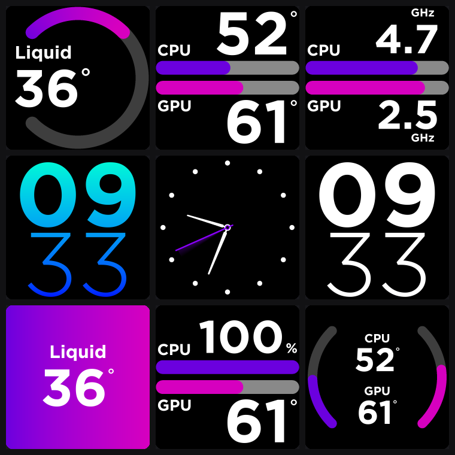
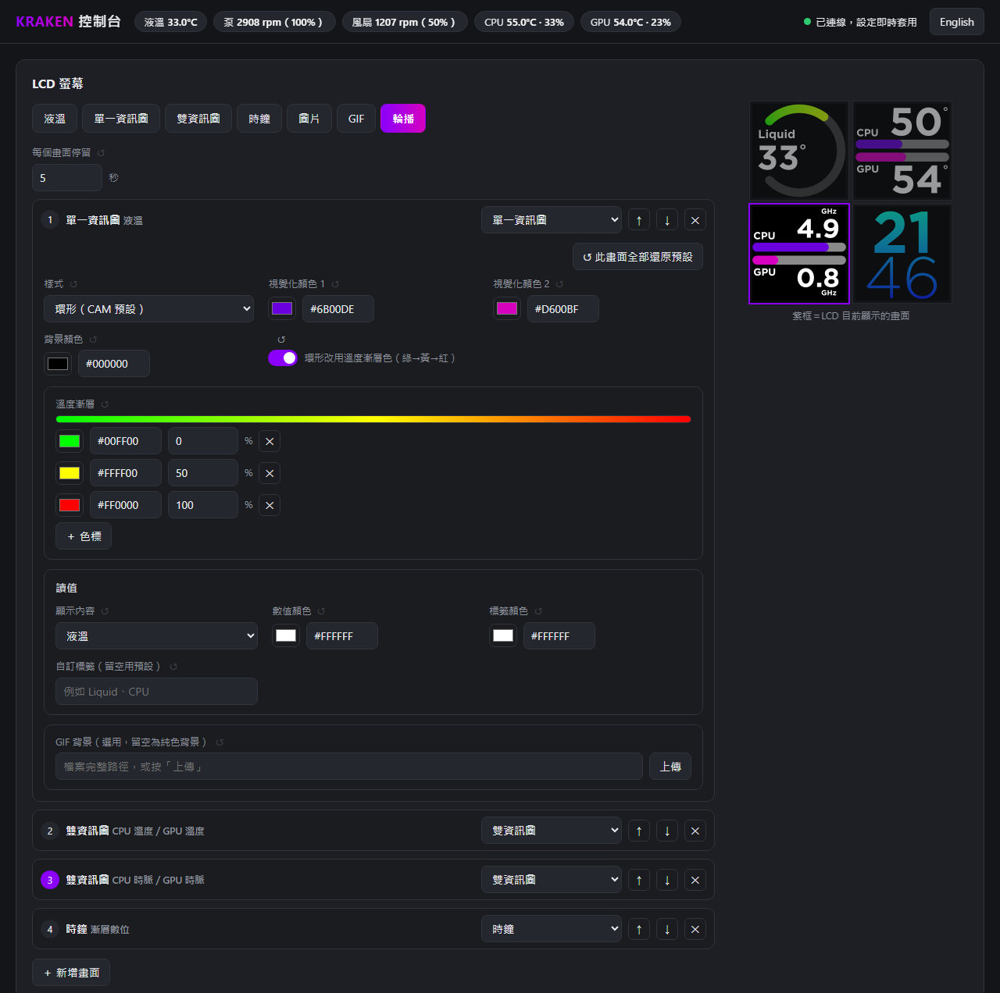
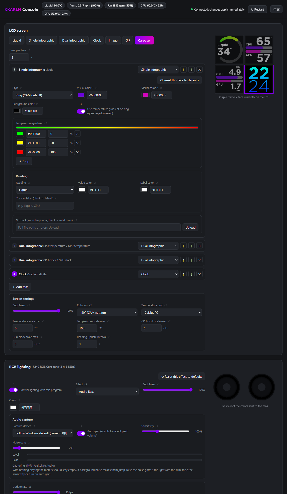

# Kraken LCD：不用 NZXT CAM 也能控制 Kraken 2024 Plus 的 LCD 與 RGB

**中文** | [English](#kraken-lcd-control-the-kraken-2024-plus-lcd-and-rgb-without-nzxt-cam)

直接透過 USB 協定控制 NZXT Kraken 2024 Plus 的 LCD 畫面與風扇 RGB，畫面樣式與燈效照 NZXT CAM 重建，附本機網頁控制台。
程式**不送任何泵／風扇轉速指令**，可以和 [Fan Control](https://github.com/Rem0o/FanControl.Releases) 同時使用：轉速交給 Fan Control，畫面與燈光交給本程式。

LCD 畫面預覽：



網頁控制台：



> 非 NZXT 官方專案，與 NZXT 無任何關係；NZXT、Kraken、CAM 為 NZXT Inc. 的商標。使用風險自負。

## 功能
- **LCD 畫面**：液溫、單一資訊圖（環形／滿版填色）、雙資訊圖（長條／弧形）、時鐘（類比／數位／漸層數位）、圖片、GIF、GIF 背景資訊圖、輪播。
  - 版面依 CAM 渲染核心的原生 240×240 預覽逐像素量測重建。
  - 字型使用 CAM 內嵌的原廠字型，執行時從本機 CAM 安裝檔取出（本倉庫不附字型）。
  - 圖片與 GIF 保留原比例完整顯示，空白處補黑邊；網頁預覽與實機畫面一致。
- **RGB 燈效**：CAM 的 20 種效果。
  - 大部分效果交給水冷韌體自己跑動畫（HUE2 `0x2A 0x04`），動畫流暢、不佔 CPU。
  - 溫度監控、波浪、音訊律動（Audio Bass／Level）由電腦端逐格送出，受韌體限制最多每秒約 2.5 格。
  - 音訊律動可指定擷取哪個播放裝置（或跟隨 Windows 預設，拔插裝置、改預設會即時反映），並調整自動增益、靈敏度與雜訊門檻；控制台有即時音量表。
- **讀值**：液溫、CPU／GPU 溫度、使用率、時脈；溫度可切換 °C／°F。
- **網頁控制台**：`http://127.0.0.1:8765`（只綁定本機），改設定約 0.3 秒後自動套用並顯示預覽；介面可切換中文／English，每個設定都能一鍵還原預設；頁首的「重新啟動」按鈕可直接重啟常駐程式（不必再按 UAC）。
- 拔線、睡眠喚醒後自動重連；LCD 每張畫面送兩次並確認回覆，避免殘影疊圖。

各功能與 CAM 的詳細對照見 [FEATURES.md](FEATURES.md)。

## 需求
- Windows 10／11、Python 3.12。
- NZXT Kraken 2024 Plus（USB `1E71:3014`）。其他型號未測試。
- 已安裝 NZXT CAM（只用來取出字型，使用本程式時請**關閉 CAM**，否則兩邊會互搶裝置）。
- LCD 介面需要 WinUSB 驅動（安裝過 CAM 通常已具備）。
- CPU 溫度借用 Fan Control 資料夾內的 `LibreHardwareMonitorLib.dll`。

```
pip install -r requirements.txt
```

## 使用
```
python kraken_lcd.py run          # 常駐執行（依 config.json）
python kraken_lcd.py ui           # 開啟網頁控制台（常駐程式沒在跑會先啟動）
python kraken_lcd.py preview      # 輸出 preview.png，不碰水冷
python kraken_lcd.py status       # 液溫、泵／風扇轉速
python kraken_lcd.py rgb ff0000   # RGB 一次設成單色
```
寫入裝置需要系統管理員權限；以系統管理員執行也才讀得到 CPU 溫度與即時時脈。

### 開機自動執行
以系統管理員身分執行：
```
powershell -ExecutionPolicy Bypass -File install_autostart.ps1
```
會建立工作排程「KrakenLCD」，登入後 10 秒以最高權限啟動；加 `-Remove` 移除。

**開機到程式啟動前**：LCD 與燈光由水冷韌體自己決定（通常是上一次的畫面或韌體預設），登入約 10 秒後程式啟動，才換成你的設定。

## 設定
所有設定存在 `config.json`，網頁控制台會直接改寫它；手動編輯存檔後也會立即套用。
圖片與 GIF 放在 `media/` 資料夾（不納入版本控制）。

## 已知限制
- Kraken 2024 Plus 韌體不支援切換到內建液溫畫面，「液溫」模式改由電腦端繪製。
- 韌體約每 0.3 秒才處理一次燈光指令，電腦端逐格送的效果（音訊律動、波浪）會有延遲感。
- Starry Night 韌體動畫的底色偏白；Wave 的韌體模式值未知，目前用電腦端逐格送。

## 授權
[MIT](LICENSE)

---

# Kraken LCD: control the Kraken 2024 Plus LCD and RGB without NZXT CAM

[中文](#kraken-lcd不用-nzxt-cam-也能控制-kraken-2024-plus-的-lcd-與-rgb) | **English**

Controls the NZXT Kraken 2024 Plus LCD and fan RGB directly over USB. Faces and effects are rebuilt to match NZXT CAM, and a local web console is included.
It **never sends pump or fan speed commands**, so it runs alongside [Fan Control](https://github.com/Rem0o/FanControl.Releases): Fan Control handles speeds, this tool handles the screen and lighting.

LCD face previews:


Web console:



> Not an official NZXT project and not affiliated with NZXT. NZXT, Kraken and CAM are trademarks of NZXT Inc. Use at your own risk.

## Features
- **LCD faces**: liquid temperature, single infographic (ring / full fill), dual infographic (bars / arcs), clocks (analog / digital / gradient digital), image, GIF, GIF-background infographics, carousel.
  - Layouts are rebuilt pixel by pixel from CAM's own 240×240 renderer previews.
  - Uses the fonts embedded in CAM, extracted at runtime from the local CAM install (no fonts are shipped in this repository).
  - Images and GIFs keep their aspect ratio with black bars; the web preview matches the LCD.
- **RGB effects**: all 20 CAM effects.
  - Most effects run as firmware animations (HUE2 `0x2A 0x04`): smooth and no CPU cost.
  - Temperature monitor, wave and audio effects (Audio Bass / Level) are streamed from the host, limited by the firmware to about 2.5 frames per second.
  - Audio effects can capture a specific playback device (or follow the Windows default; plugging/unplugging devices and changing the default take effect live), with auto gain, sensitivity and a noise gate; the console shows live level meters.
- **Readings**: liquid temperature, CPU/GPU temperature, load and clock; °C or °F.
- **Web console** at `http://127.0.0.1:8765` (localhost only); changes apply about 0.3 s after editing, with a live preview. The UI switches between Chinese and English, and every setting has a one-click reset to default; the Restart button in the header restarts the background program (no UAC prompt).
- Reconnects after unplugging or sleep; each LCD frame is sent twice and confirmed to avoid ghosting.

See [FEATURES.md](FEATURES.md) for the full comparison with CAM.

## Requirements
- Windows 10/11, Python 3.12.
- NZXT Kraken 2024 Plus (USB `1E71:3014`). Other models are untested.
- NZXT CAM installed (only to extract its fonts). **Keep CAM closed** while using this tool, or both will fight over the device.
- The LCD interface needs the WinUSB driver (usually present once CAM has been installed).
- CPU temperature uses `LibreHardwareMonitorLib.dll` from the Fan Control folder.

```
pip install -r requirements.txt
```

## Usage
```
python kraken_lcd.py run          # run continuously (from config.json)
python kraken_lcd.py ui           # open the web console (starts the runner if needed)
python kraken_lcd.py preview      # write preview.png without touching the cooler
python kraken_lcd.py status       # liquid temperature, pump/fan speed
python kraken_lcd.py rgb ff0000   # set all RGB LEDs to one color
```
Writing to the device needs administrator rights; running as administrator also lets it read CPU temperature and live clocks.

### Autostart
Run as administrator:
```
powershell -ExecutionPolicy Bypass -File install_autostart.ps1
```
This creates a scheduled task "KrakenLCD" that starts with highest privileges 10 seconds after you log in; add `-Remove` to uninstall.

**Before the program starts at boot**, the LCD and lighting are whatever the cooler firmware shows (usually the last image or the firmware default). About 10 seconds after login the program takes over with your settings.

## Configuration
All settings live in `config.json`. The web console writes to it, and manual edits apply as soon as the file is saved.
Put images and GIFs in the `media/` folder (not tracked by git).

## Known limitations
- The Kraken 2024 Plus firmware cannot switch to its built-in liquid screen, so liquid mode is drawn on the host.
- The firmware only processes a lighting command about every 0.3 s, so host-streamed effects (audio, wave) feel laggy.
- The Starry Night firmware animation has a whitish background; the firmware mode value for Wave is unknown, so it is streamed from the host.

## License
[MIT](LICENSE)
